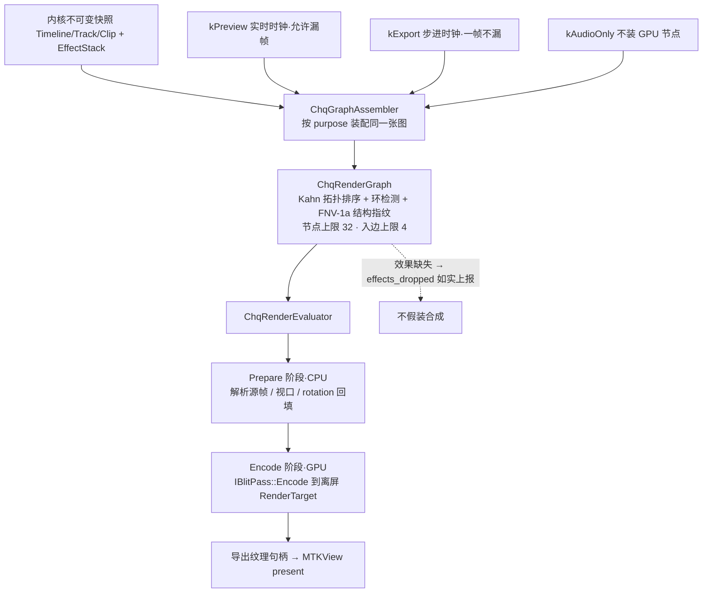
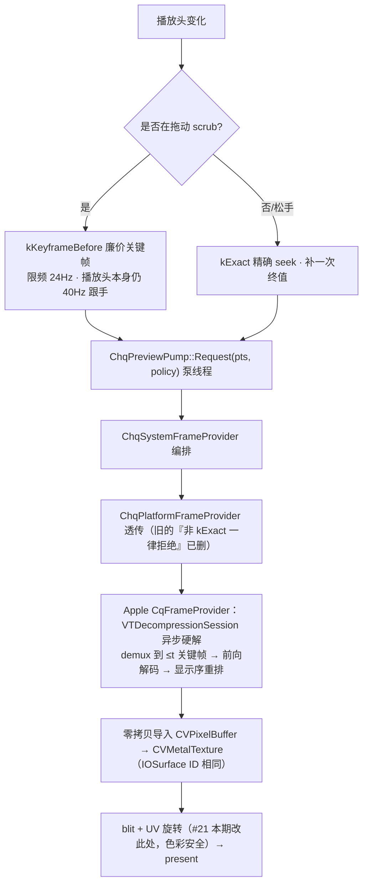
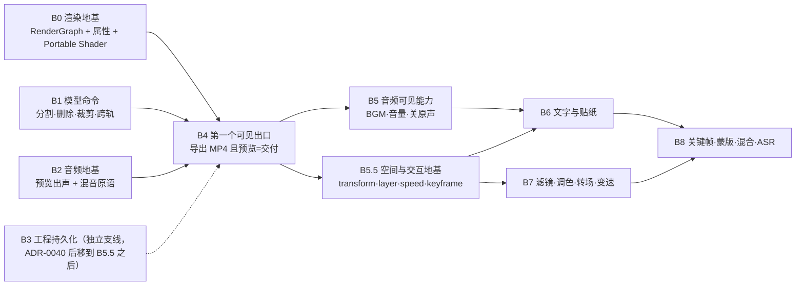

# ChuanqiCut · 项目周报（最新一期）

> **一句话**：跨平台视频编辑 SDK + 各端原生 App —— C++20 共享内核（纯 C ABI）+ Apple 平台适配 + SwiftUI/UIKit 原生 UI，目标是能拍、能剪、能出片。
>
> 本文件 = **最新一期周报全文**（W42 第三刊，覆盖 2026-10-13 ~ 10-16），既是进展汇报，也当项目门面：§1~§3 讲清架构与 Pipeline，§4~§7 讲各模块技术方案与实况。
> 归档编号：`docs/reports/WEEKLY-2026-W42-03.md`（同一期内容，下期起本文件随之替换）；历史各期见 [`docs/reports/`](docs/reports/README.md)。
> 出刊：集成机（macOS 26.7.1 / Xcode 26.6 / Swift 6.3.3 / cmake 4.4.3 / **Intel x86_64**）。真机 = iPhone 17 Pro / iOS 26.6.1。
> 数字纪律：**只写实测**，估算标 `[E]`、未取证标 `hypothesis`；门禁写具体 PASS/FAIL，不写"全绿"。
> 想动手改代码：先读 [`AGENTS.md`](AGENTS.md)（根规则）与 [`docs/README.md`](docs/README.md)（文档地图），本文件不替代它们。

---

## 0. 本期速览

1. **B0 渲染地基落地**（10-13 `6ccf29b`，**62 文件 / +5727 −346**）：`ChqRenderGraph`（节点 DAG + Kahn 拓扑 + 环检测 + FNV-1a 结构指纹）、`ChqGraphAssembler`（**预览/导出/纯音频三图同源**）、`ChqRenderEvaluator`（CPU Prepare / GPU Encode 两阶段）、`ChqClockSource`（步进 / 实时）。**红线 #9「预览与导出走同一张 RenderGraph」从愿景变成代码**；预览渲染器已切到该图，`preview_renderer` **51/51 与原 blit 路径像素一致**。合并快检 ctest **52/52**。
2. **两条"从未跑通"的地基同时补齐**：SHADER-001 Portable 链首次跑通（`shaders/src/blit.{vert,frag}` → glslang 16.0.0 → SPIR-V → SPIRV-Cross → MSL，产物 `blit_msl.h` 被 `blit_pass.mm` 消费，手写内联 MSL 退役）；MODEL-003 属性系统落地（`PropertyValue`/`PropertyBag` + `EffectBinding`/`EffectStack` 挂 `ChqClip`，4 条命令 + **11 个 ABI**）。
3. **轨道区换心脏**（ADR-0042 / UIA-044，10-15）：**删除 715 行自绘** `EditorTimelineUIView`，改接本地 UIKit 组件 `TimelineKit` + 新建 `TimelineKitAdapter`（映射）与 `EditorTimelineKitView`（容器）。**内核仍是唯一数据真源**：灌入 = 快照重建 store，回写只走 `.projectChanged → TrackIntent → TrackIntentApplier`，翻译不了的命令一律回滚。真机跑通：`[tk:track] rebuild tracks=1 clips=1 assets=1`、**零 resync、零崩溃**。
4. **一次必现 SIGSEGV 治本 + 治理门禁化**（10-14~15）：自绘层全清 `layer.sublayers` 把子视图 backing layer 一起拔了 → CA 提交解野指针；真机 6+ 组二分定性，修复 = 专用 `canvasLayer`。**新门禁** `tools/compliance/check_uiview_layer_hygiene.py` 已挂进 `run_gate.sh`（step `layer-hygiene`，紧随 deps/headers），**116 文件 PASS、零假阳性**。同期 ADR-0041 把编辑器 UIKit 布局统一到 SnapKit，并抓到"红框解成 0×0 的假功能"（P130）。
5. **scrub 卡顿结案**（ADR-0043 / P142，10-16 `c5d4bf5`）：根因 = 拖动每个 delta 走 `kExact`，**每次从最近关键帧重解整个 GOP**；而内核 `kKeyframeBefore`/`kNearest` 早已实现，被"Platform 接缝不携带 policy"挡死。改为**拖动中廉价关键帧 + 24Hz 限频、松手补一次精确帧**，并把策略以中立 `int32_t` 打通整条接缝。窄检 `ctest` **6/6 PASS**（含真素材 69s）。
6. **#21 竖屏旋转返工**（10-15~16）：v1 在解码层用 Core Image 转像素 → 无标签 BGRA 被做色彩空间转换 → **色偏**；回退为**解码只下发 rotation 元数据、GPU blit 重烤 UV**。编译期抓到 `uint8_t` 截断（`270→14`，静默丢 270° 源）；真机首轮"画面倒立"→ UV 层须施加**逆旋转** `(360-R)%360`，已修待复核。
7. **依赖线接线空转结案**（DEPS-012 / P140，10-16 `3536e8b`，已 push）：`vendored_libraries` 喂 `.xcframework` 被 CocoaPods **静默忽略、零 warning**，App 链接行自 10-11 起一直缺 `-l"ffmpeg"`，却因无人调用符号而 BUILD SUCCEEDED。改 `vendored_frameworks` 后双端 xcconfig 均含 `-l"ffmpeg"`，最小链接实测 **775 个 `_av*` 符号**、无需补 `-lz/-lbz2/-liconv`。
8. **最该记住的一条（延续第二刊）**：**仍然不能导出成片**。本期重测 `cq_sdk.h`：**89 个 `cq_*` 函数声明，`cq_export*` / `cq_encode*` = 0**。B4 出口依赖 B0 真机问卷回收；**全量 `run_gate.sh` 自 10-12 后未再跑**（本期只有窄检 + 双壳构建），工作树尚有 **33 项**在途变动、`c5d4bf5` 未 push。

---

## 1. 项目介绍

ChuanqiCut = **跨平台视频编辑 SDK + 各端原生 App**，目标形态是"能拍、能剪、能出片"的商用剪辑底座。

| 层 | 位置 | 内容 |
|---|---|---|
| **共享内核** | `engine/core/cq/` | C++20：时间/模型/命令/会话/媒体/渲染图/预览/音频/AI plan，对外**纯 C ABI** |
| **平台适配** | `engine/platform/apple/` | Metal / AVFoundation / VideoToolbox / CoreImage / AudioToolbox（Android·OHOS 目前仅 CMake 骨架，**零源码**） |
| **原生 UI** | `apps/apple/{ios,mac,packages}` | SwiftUI 外壳 + UIKit 编辑三件套（ADR-0024） |

**规模实况（本期实测）**：内核 100 个 `.h/.cpp` / **15,904 行**；Apple 平台层 15 个 `.mm/.h/.cpp` / **5,068 行**；`apps/apple` 非 Pod **119 个 `.swift`**；单测 51 个 TU；公共 ABI 89 个函数。

**架构红线（违反即驳回）**：除 UI 外一切下沉 C++；Platform 头零平台类型；能力运行时查询（`cq_query_capability`）不用编译期推断；时间一律 `ChqRationalTime`（**项目 timescale = 120000**，ADR-0009）；UI 不得直接改模型，全走 `Command`；Shader 双层且 Portable 先行；第三方类型不进公共头；主线程零阻塞、音频线程无锁无分配；**预览与导出同一张 RenderGraph**。

**性能基线**：高端满足、中端可用、**明确不适配低端机**（RAM ≥6GB / GLES 3.1 门槛）；能力缺失降级照做（无硬解→软解），但不为低端机写专用路径。

**协作形态**（ADR-0029/0030）：本机 = **集成机**（唯一发号器、全局册单写者、全量门禁与真机唯一验收口径）；开发机编码优先 + 待办池登记。**同工作区多 agent 并行是常态**，写集不相交是硬约束；**一批未验收不得在其上叠加下一批**（ADR-0034）。

---

## 2. 技术架构（代码实况，不是愿景图）

### 2.1 分层与 Pod 拓扑

```
┌─ 壳 App（apps/apple/ios + mac）：路由/权限/装配，零业务
│    ├─ ChuanqiCutEngine     Swift 绑定层（Session/Previewer/PreviewPump/PreviewAudio/Player/Timeline/Time）
│    │     └─ ChuanqiCutCore C ABI + C++20 内核 + Apple Platform（唯一 public 头 cq_sdk.h）
│    │           └─ ChuanqiCutFFmpeg  LGPL-2.1 义务载体（ADR-0036/0038）
│    │                 └─ vendor/libffmpeg.xcframework  vendored_frameworks（本期修对，P140）
│    ├─ SharedUI           基座（仅 Common/，三个跨域注入器）
│    ├─ ChuanqiCutEditor   ├ Core 子 spec（mac 引）  └ TimelineKitTrack 子 spec（iOS 引，ADR-0042）
│    ├─ ChuanqiCutPlayer / Import / Camera(iOS 专属) / Draft(骨架)
│    └─ TimelineKit        仓库外本地 Pod（UIKit-only 时间线组件）  ⚠️ 见 §9 风险
└──────────────────────────────────────────────────────────────
功能 Pod 横向零依赖；跨域交接走基座注入器 + 壳装配。
```

- CMake 顺序：`third_party → engine/core → engine/platform → apps → tools → tests`；主目标 `cq_core`、`cq_platform_apple`、`cq_ffmpeg`、`cq_render`（本期新增）。
- 警告集 `-Wall -Wextra -Wconversion -Wshadow -Wold-style-cast` + **`-Werror`**，禁止 `-Wno-*` 逃逸。
- 顶层 `LANGUAGES C CXX` 的 C 是为让 `test_c_abi*.c` 成为**真正的 C 翻译单元**，机器校验 ABI 纯净性。

### 2.2 内核子模块地图（`engine/core/cq/`，实际目录）

| 子模块 | 职责一句话 | 状态（本期） |
|---|---|---|
| `base` | `ChqRationalTime`、`ChqStatus`、日志（带 workflow 维度）、纹理预算账本、并发原语 | 已实现 |
| `platform` | **契约头（仅声明）**：gfx/media/audio/inference/fs/clock/log/capabilities/net 九域，零平台类型 | 已实现·冻结（43 头 0 违规） |
| `model` | `ChqTimeline/Track/Clip` + **`chq_property`（属性系统，本期新）** + 快照 | 已实现·MODEL-003 落地 |
| `command` | `ChqICommand` + `ChqCommandHistory`（Undo/Redo，只存增量） | 已实现 |
| `session` | `ChqEditorSession` 门面 + `ChqTaskRunner`（kSession 串行线程）+ 8 类线程角色 | 已实现 |
| **`render`** | **`ChqRenderGraph` + `ChqGraphAssembler`（三图同源）+ `ChqRenderEvaluator`（两阶段）+ `ChqClockSource`**（**本期新增**） | **已实现·B0**，效果节点未做 |
| `gfx` | `ChqIGfxDevice`/`ChqIGfxEncoder` 编排层（在 Platform HAL 之上） | 已实现；TexturePool（GFX-002）未做 |
| `media` | 帧缓存 LRU、解码器池、`ChqSystemFrameProvider`（三种 seek 策略编排）、`ChqAssetRegistry` | 已实现；**缓存未接进预览** |
| `preview` | `ChqPreviewRenderer`（已改吃 RenderGraph）、`ChqPreviewPump`（取帧泵线程）、`ChqPlayerClock` | 已实现 |
| `audio` | PCM 池（Treiber）、SPSC 无锁环、`ChqPreviewMixer`、**`chq_mix` 混音原语（本期新）** | 已实现·MVP |
| `ai` | **只有 `ChqEditPlan` JSON 校验器 + golden**，无推理运行时 | 已实现·仅 plan 校验 |

**关键否定事实（本期重核）**：内核仍**无** `export/`、`project/`、`effect/`、`retime/`、`inference/` 目录 —— **导出、草稿持久化、时间拉伸三大块都还没有代码**。

### 2.3 跨层接口

- **C ABI**：`engine/core/cq/cq_sdk.h`，**89 个函数**（本期实测）：session 41 / preview 20（含新增 `cq_preview_pump_request_ex`）/ player 11 / audio 4 / status 4 / version 3 / log 2 / media 1 / capability 1 等。`cq_export*` = **0**。
- **Platform 契约 vs 实现**：契约 9 域头文件，Apple 实现 `engine/platform/apple/{base,gfx,media}/`；门禁 `tools/platform/check_platform_headers.py` **实测有效**（插 `jobject` 会被抓）。跨层用 opaque 句柄 + `ChqPlatformPtr<T>` RAII。
- **本期新增接缝约定**（ADR-0043）：`ChqIFrameProvider::Seek/AcquireFrame` 末尾以**中立 `int32_t`** 携带 core 的 `ChqSeekPolicy`（0/1/2）。原因是 `chq_frame_provider.h` 已 include `chq_media.h`，反向 include 成环（P142）。**新平台若不支持非精确策略必须显式拒绝**，不得静默当精确处理。

---

## 3. 关键 Pipeline

### 3.1 渲染：一张图、三个时钟（B0 已落地）



- **预览与导出同源**是这个批次的全部意义：B4 出口时不必再证明"预览=交付"。
- **诚实降级**：节点上限、未支持的效果都会打 Warn 上报（`chq_graph_assembler.cpp:77` 明写"多轨命中 N 条但 B0 只渲染第一条，多轨合成归 RENDER-011"）。
- ⚠️ **多轨合成仍未做**：`chq_preview_renderer.h:24` 与装配器一致 —— 只渲染**第一条命中的视频轨**。模型层已支持多轨（`MoveClipToTrack`），渲染只画第一轨。pass 合并、纹理别名、LOD、效果节点全部未实现。

### 3.2 编辑：手势 → 命令 → 快照 → UI diff（含本期轨道区换件）

```mermaid
flowchart LR
    T["UIKit 手势 / TimelineKit 事件"] --> RED["TrackInteraction reducer<br/>命中判定·RationalTime 换算·唯一一份"]
    RED --> AP["TrackIntentApplier"]
    AP --> VM["EditorViewModel.submit 主线程唯一 VM"]
    VM --> ABI["C ABI cq_*"]
    ABI --> SESS["ChqEditorSession<br/>ChqTaskRunner kSession 串行"]
    SESS --> CMD["ChqCommand → CommandHistory<br/>只存增量 · Undo/Redo"]
    CMD --> PUB["发布不可变快照 version + FNV digest"]
    PUB --> OBS["观察者回调 → Task @MainActor → UI diff"]
    OBS -->|"翻译不了的命令"| ROLLBACK["回滚重灌 store · 组件不持有真源"]
    ROLLBACK --> SESS
```



- **红线 #5 有机制背书**：`Submit` 异步不阻塞（实测 0.005~0.010ms，刻意不提供 `SubmitAndWait`）；UI 侧拖拽只动本地预览层，松手提一条命令（ADR-0012）。
- **本期 U0 收敛**（UIA-041）：SwiftUI 423 行 / UIKit 469 行两份时间轴手势与 commit 逻辑**合并成一份 reducer**，并顺带修掉两处双实现行为分歧（零位移是否提交、末次位移取哪个）。测试 65 → **81**（+16）。
- **真源方向裁定**（ADR-0042）：`TimelineKit` 的 `TimelineStore` 快照**不得另行持久化**，回写入口唯一。
- ⚠️ **持久化 PROJ-001 未开工**：项目状态只活在内存 Session，**进程退出即丢**；ADR-0040 已把 B3 排在 B5.5 之后（否则序列化改两遍）。

### 3.3 取帧与 seek 策略分流（本期新增，ADR-0043）



- **根因**：长 GOP 下每次精确 seek 都要从最近关键帧重解整段，解码占满泵线程单核、与滚动主线程抢核 → 卡顿；**向后拖更贵**（要找更早关键帧再正向解）。
- **音画/时序**：解码输出队列上界 12 帧、缺口判定 streak 8、`Flush` 轮询 + 1s 超时（`VTWait` 会永久阻塞）；`ChqDecoderPool` 默认最大硬件路数 1，超限返回 `kResourceExhausted`，不抢占不降级。
- ⚠️ **两处已知欠账**：`ChqPlatformFrameProvider` 的 `SetFrameCache`/`SetDecoderPool` **仍不生效**（Platform 契约未暴露注入点，预览因此没接帧缓存，头文件自陈）；`FFmpegFrameProvider`（MEDIA-021）未开工 → 运行时 FFmpeg **零参与**，解码全走 AVFoundation/VideoToolbox。

### 3.4 音频链（AUDIO-002 贯通 + 本期 AUDIO-004 原语化）

`ChqIAudioTrackReader`（契约）→ `ChqPreviewMixer`（时间线→PCM：快照命中 + 逐 clip 独立读位 + 求和削波 + 漂移护栏 + 欠载重锚）→ **`chq_mix` 混音原语**（本期抽出，混音器内联实现已删，**不留第二套混音路径**）→ Apple `AVAssetReader` PCM + `AVAudioEngine`/`AVAudioSourceNode` + **SPSC 环（唯一无锁执行点）** → C ABI `cq_audio_preview_*` → Swift `PreviewAudio`。

- **诚实边界**：音画同步 MVP 是**视频（墙钟）为主、音频为从**，缓冲区与外推播放头差 >120ms → Flush + 重锚；欠载 = 静音缺口不伪造。ARCH-001 §5.3 的"以音频为主时钟"是愿景，全量 A/V 同步归 MEDIA-030（未开工）。
- **本期 #18 治本**：App 挂起/被其他播放器抢会话后回来无声 —— `AppleAudioEngine::Start()` 的 `if (started_) return` 早返回使恢复变 no-op。改为幂等注册打断/前台观察者 + `ReactivateIfNeeded()`（重激活 `AVAudioSession` 并按 `isRunning` 重启引擎），仅 iOS 分支（**macOS 回归已补 `#if TARGET_OS_IPHONE` 守护**）。

### 3.5 相机采集链（iOS 原生域，不经 SDK/C ABI，ADR-0014 豁免）

```
采集 CameraManager（AVCaptureSession，配置/启停全在 sessionQueue）
   ├ videoQueue → CameraFrameSlot.push（latest-wins，不排队）
   └ audioQueue → CameraRecorder.appendAudio
检测 AVCaptureMetadataOutput 系统脸框（零 Vision）+ Vision 按需开关（BeautyDetectionPlan 纯函数决定）
渲染 CameraPreviewRenderer（MTKViewDelegate）
   ✗ CI → drawable（framebufferOnly 缺 ShaderWrite → 静默黑屏，P60）
   ✗ CI → 中间纹理 → blit → drawable（禁对 framebufferOnly 纹理 blit → SIGABRT，P65）
   ✓ CI → 自建中间纹理(ShaderWrite|ShaderRead, private) → 显式 UV 渲染 pass → drawable
录制 CameraRecorder（AVAssetWriter + PixelBufferAdaptor），与预览/拍照共用同一条「美颜→滤镜」链（WYSIWYG）
```

**黏性回落纪律**：引擎闭包连续 3 次 nil → 本会话停用、只走默认 CI（否则逐帧在两种视觉间翻转 = 真机"磨皮闪屏"主嫌）。产物验收：**编译绿 ≠ metallib 可用**，`strings | grep cq_beauty` 必须出现两个 kernel 名（96B 是空壳，实测 9391B）。

### 3.6 Shader 两层（本期从"降级"变成"真双链"）

| 层 | 位置 | 实况（本期变化） |
|---|---|---|
| **Portable**（GLSL 4.50 → SPIR-V → MSL） | `shaders/src/blit.{vert,frag}` → `build/generated/shaders/blit_msl.h` | ✅ **链首次跑通**：`tools/shaders/build_shaders.py`，双构建接线（CMake custom command + podspec `script_phases`），幂等产物，spike `metal -c` rc=0。**上一期是零 .glsl、链从未跑过** |
| **Platform-Native** | `blit_pass.mm` 吃生成产物；手写 `blit_fullscreen_msl.h` **已退役** | ✅ 不再是"能力缺失降级路径" |
| App 域特效 | `ChuanqiCutCamera/.../Effects/{beauty_bilateral,beauty_guided,face_warp}.metal` | ✅ 已实现，Xcode 编进 `default.metallib` |

⚠️ 未做：reflection JSON、多 shader 管理、Native 加速；UI 侧 `PreviewFrameRenderer.swift` 仍是手写 MSL（决定本批不合并）。

---

## 4. 分模块进展（本期主表）

| 模块 | 技术方案要点 | 本期动作（10-13~16） | 状态 / 证据 |
|---|---|---|---|
| `render`（新） | 节点 DAG + 装配器三图同源 + 两阶段求值 + 时钟源接口，Pull 模型 | **B0 落地并提交**（`6ccf29b`） | ctest 52/52；`preview_renderer` 51/51 像素一致；**真机问卷未回收 → 不标记完成** |
| `model` | 属性即数据：`PropertyValue/Bag` + `EffectBinding/Stack` 挂 clip（有序 map、float 标量） | **MODEL-003 落地**：4 命令 + 11 ABI | `model_property` 179 检查 / `c_abi_property` 76 检查 0 失败；关键帧/插值未做（B5.5） |
| `shader` | Portable 先行、Native 可选，收益 <20% 不合入 | **SHADER-001 落地**，双构建接线 | `blit_msl.h` 幂等生成、blit 消费；手写内联退役 |
| `preview` | 泵线程独占取帧·解码·离屏，主线程只 blit；blit 与内核共用一条 `MTLCommandQueue` | **P142 seek 策略透传**（`c5d4bf5`，15 文件 +352/-29）；#21 rotation 经 `ChqRenderNodeDesc.source_rotation` 回填 | 窄检 `ctest -R` **6/6 PASS**（含真素材 69s）；iOS 壳绿；**真机待复验** |
| `media` | 两层帧管线（core 编排 + Platform provider）、LRU 缓存 lease=move-out、解码器池闸门 | seek 策略贯通并**删除"非 kExact 一律拒绝"**；`media_decode.mm` rotation 元数据下发 | `media_sequential_real` 通过；缓存/池注入点仍不生效（欠账登记） |
| `gfx` | Platform HAL（`cq/platform/chq_gfx.h`，冻结）+ core 编排门面；ADR-0018 视口接缝 | **#21 改此处**：`blit_pass.mm` `RotateUv`/`BakeRotation` 重烤 UV；旋转角全链 `uint8_t → uint16_t` | 双壳 BUILD SUCCEEDED 0 错、无新增 warning；真机首轮倒立已修待复核 |
| `audio` | PCM 池 + SPSC 无锁环 + 预览混音器（30Hz 喂数线程） | **AUDIO-004 混音原语**（57 检查）；**#18 打断恢复** | ctest Debug 52/52；`ctest -R audio` 5/5；零分配实测 operator new 增量 0；**真机可听感路径未做**（PALA-030） |
| `platform`（契约） | 九域头文件、零平台类型、能力运行时查询 | `int32_t` 中立 seek policy 跨接缝（ADR-0043） | 平台头门禁 **43 头 0 违规** |
| `platform-apple` | Metal/VT/AVFoundation 后端、零拷贝 IOSurface 对齐 | `audio_engine.mm` 观察者 + `media_decode.mm` transform；P122 轻 probe 工厂存量 | 双壳绿；**App 运行时零 FFmpeg** |
| `ui-apple`（编辑） | SwiftUI 外壳 + UIKit 三件套；命令模式 + 快照 diff；SnapKit（ADR-0041） | UIA-041 U0/U1 → **UIA-042 SnapKit + SIGSEGV 治本 → UIA-043 单色系改版 → UIA-044 TimelineKit 接入 → UIA-045 十项回归** | Editor `swift test` **81/81**；双壳绿；真机 `[tk:track]` 零 resync；**UIA-044/045 未提交、问卷未回收** |
| `camera` | iOS 原生栈、latest-wins 槽、自研 Metal + CI kernel 并存 | 本期**无新动作**（存量：CAM-033/034/035 + SIGTRAP 治本） | Camera 77 测试存量绿；池 [15] 剩余项未清 |
| `deps` | `manifest.toml` 锁 commit、source\|binary 双集成、FFmpeg demux 档 <3MB、无 `--enable-gpl` | **P140 接线修对**（`3536e8b`，已 push）、ADR-0038 勘误、Editor 子 spec 收口 | 双端 xcconfig 含 `-l"ffmpeg"`；最小链接 775 `_av*`；slice 体积核对 |
| `session` | 单 kSession 线程串行、`shared_ptr<const>` 快照、异步 submit / 同步查询 | 随 B0/P142 被动验证 | B0 批 52/52 内含；**EDIT-012 commit/done 双层 PreviewSync 待拍板（P0 未排期）** |
| `export` | — | **零进展** | ❌ 未开工：无 `cq_export*`，导出按钮置灰；底层 `AppleVideoEncoder`/`AppleMediaMuxer` 已编译进产物（H.264+AAC MP4 实测可写），缺口在上层控制器 + ABI + UI |
| `project` | schema 版本 + 迁移器链（ADR-0006） | **零实现** | ❌ PROJ-001~004 未开工；ADR-0040 把 B3 排到 B5.5 之后 |
| `ai` | 特征上云、素材不出设备、EditPlan 校验（ADR-0020） | 无动作 | AIEDIT-001 契约冻结存量（58 golden、9 动词）；002~011 未开工 |
| Android / OHOS | 设计基线（minSdk 26、arm64-v8a、GLES 3.1、Oboe、TFLite） | 无 | **诚实：零实现** —— 各端仅 1 个 `CMakeLists.txt`，绑定目录仅 `.gitkeep`；契约无 `CreateFrameProvider`，链接期即失败 |

**流程与治理侧（本期新增资产）**

- **图层卫生门禁**：`tools/compliance/check_uiview_layer_hygiene.py` 进 `run_gate.sh`（step `layer-hygiene`，紧随 deps/headers），**116 文件 PASS、零假阳性**；接入当天就精确定位到当时自绘层的 `EditorTimelineUIView.swift:321`（该文件本期已由 UIA-044 删除）—— P131 事故的制度化。
- **可观测性通道**：新增 DEBUG stderr `[tk:track]`（rebuild/resync）、`[tk:perf]`（播放头成本）；`DebugCrashDumper.swift`（devicectl 起的崩溃不落 .ips、lldb attach 取不到栈 → 信号处理器直出回溯）。
- **排期重构**（ADR-0040 + RESEARCH-016/017）：立 B5.5（`TASK-MODEL-004` 变换/层级/变速/关键帧、`TASK-EDIT-012` commit/done 双层），B3 后移，B6/B7 自此可并行。
- **脱敏**（10-15）：竞品标识全仓 + git 全历史清理（`git filter-repo`），本档统一以"对标 App / 对标平台"指代。

---

## 5. 关键数字（实测，带机器环境）

**门禁与窄检**

| 日期 | 命令 | 结果 |
|---|---|---|
| 10-12 | `bash tools/ci/run_gate.sh`（**最近一次全量**） | **PASS=14 / FAIL=0 / SKIP=0，22m14s**；core-dbg 48/48、core-rel 48/48、bindings 26、camera 77、import 16、editor 65、player 52 |
| 10-13 | B0 合并快检 | `build_core.sh` Debug 3m49s **0 错 0 警**（-Werror）；`ctest` **52/52**（78.66s）；冲突标记 0；PAL 残留 0 |
| 10-13 | AUDIO-004 | `ctest` Debug **52/52**；`ctest -R audio` 两端 5/5；`core_audio_mix` **57 检查 0 失败**；平台头门禁 43 头 0 违规 |
| 10-13 | UIA-041 | Editor `swift test` **81/81**（+16）；双壳 BUILD SUCCEEDED |
| 10-14 | UIA-042 + SIGSEGV 治本 | 双壳 BUILD SUCCEEDED；`UIKit/` 原生布局代码 0；真机 push / `CQ_AUTO_ROUTE` 各 25s **零崩溃、零约束冲突**；图层卫生 116 文件 PASS |
| 10-15 | UIA-044/045 | 双端 `pod install` 0 错；iOS（generic）+ mac（x86_64）双壳绿；组件源码改动 3 处（传哲授权） |
| 10-16 | P142 + #21 | `build_core.sh --platform=apple` 通过；`ctest -R "preview_pump\|preview_renderer\|system_frame_provider\|c_abi_preview\|sequential"` **6/6 PASS**；iOS + macOS 双壳 BUILD SUCCEEDED |
| 10-16 | DEPS-012 | 双端 xcconfig 含 `-l"ffmpeg"`；slice 核对 iOS arm64 **2.8M** / mac fat **5.4M**；最小链接 **775 个 `_av*`** |

**真机（iPhone 17 Pro / iOS 26.6.1 / Debug）**

| 项 | 数字 | 备注 |
|---|---|---|
| 编辑页播放剖面（10-15，6s 窗口，1 轨 1 片段 8s） | 主线程 tick **p95 0ms**；泵 req/s **120–122**；rendered/s 65–120（循环 seek）；MTK draw/s 119–120；音频 drop/underrun/resync **0/0/0**；footprint **97.2→98.3MB 无增长**；零崩溃 | ⚠️ 样本极小，**不得作产品阈值** |
| 播放头推进主线程成本（`[tk:perf]`） | 未节流 **84 次/s · avg 2.31ms ≈19% 主线程** → 30Hz 节流后 **26 次/s · avg 3.81ms ≈10%** | 组件 `setCurrentTime` 连带跑三套布局；1 片段样本 |
| 相机（W42 前段存量） | guided 磨皮 **0.8~2.1ms**；半分辨率全链 **0.8~1.8ms**；Vision 单次 **11.6~20.3ms** | 满帧；内存锯齿 240~276MB |
| 零拷贝 vs CPU 退化 | **≈0.003ms vs ≈5.1ms（约 1500×）** | IOSurface ID 实测相同 |

**本机其他**：顺序取帧快路径 120 帧 acquire **93.3ms → 4.45ms**（Release）；时间线自绘布局 500 片段 **0.663ms/帧**（已被 TimelineKit 取代，作历史参照）；App 净启动成本 ≈0。

**数字纪律现状**：`baselines.md` 开篇仍自陈「尚未建立」，渲染/媒体/内存三表实测列大量为"—"；**本期新增的编辑页播放剖面已入册但明确标注样本极小**。P142/#21 的 before/after 拖动帧率与 seek 耗时**待真机复验回填**。

---

## 6. 优点与缺陷

### 6.1 做对了什么（本期新增部分）

1. **地基一次补三块、且互相解耦**：B0（RenderGraph）+ SHADER-001（Portable 链）+ MODEL-003（属性）在同一批落地，为 B4/B6/B7 清掉三个前置 —— 且 `preview_renderer` 用**像素一致**证明切换无回归，而不是只用"编译通过"。
2. **红线靠机器背书，不靠自觉**：图层卫生检查、平台头检查、真 C TU 的 ABI 校验、`-Werror` 禁逃逸、`static_assert` 禁浮点时间。本期 P131 事故**当天转成门禁条目**，这是治理闭环速度的一次实证。
3. **"两套实现"零容忍继续生效**：U0 把双份时间轴手势/commit 收敛成一个 reducer；AUDIO-004 删掉混音器内联实现改用原语；#21 明确不在 blit 和视口层各加一套旋转（守红线 #9）。
4. **否定事实写进代码**：多轨"只渲染第一条"、缓存"注入不生效"、FFmpeg"运行时零参与"都在头文件自陈 —— 不靠 README 承诺。
5. **接线类 bug 用最小可复现证明**：`vendored_frameworks` 那次用一条最小 TU 链出可执行 + `nm` 数符号（775）来证明依赖真的进链接行；同类手法还抓到 `uint8_t` 截断（270→14）。

### 6.2 缺陷与技术债（按严重度）

| # | 缺口 | 证据 | 影响 |
|---|---|---|---|
| 1 | **导出链整体未做** | `cq_sdk.h` 89 函数里 `cq_export*` = 0；`export.md` 未开工 | **不能出片的剪辑软件仍是 Demo**。底层能力已具备，缺上层控制器 + ABI + UI |
| 2 | **B0 之后全部排队，而 B0 卡在一纸问卷** | 6 份真机问卷未回收（B0 + UIA-041~045）；全量门禁自 10-12 未跑 | ADR-0034「一批未验收不叠加」→ 关键路径当前**不在代码上，在验收上** |
| 3 | **多轨合成未做** | 装配器/渲染器双双自陈"只渲染第一条命中视频轨"，效果节点未实现 | 画中画、叠放、转场全部等 RENDER-011；RenderGraph 目前只是"一张只有一个绘制节点的图" |
| 4 | **草稿持久化零实现** | 无 `project/` 目录；`ChuanqiCutDraft` 仅骨架 | 关 App 即丢；B3 已排到 B5.5 之后 |
| 5 | **空间/交互模型缺字段**（ADR-0040） | `ChqClip` 无 transform / layer / speed / keyframes | B6 贴纸定位、B7 画中画与变速、B8 关键帧会返工 —— 故必须先做 B5.5 |
| 6 | **预览没接帧缓存 / FFmpeg 后端** | `SetFrameCache`/`SetDecoderPool` 在适配层不生效；`FFmpegFrameProvider`（MEDIA-021）未开工 | 递进单帧 total 99.3ms、取帧占 94% 的老账仍未彻底翻篇 |
| 7 | **TimelineKit 是仓库外本地 Pod** | `Podfile:34 pod 'TimelineKit', :path => '../../../../ChatGPT/zui'` | 换机/CI **不可复现**；且本期已改组件源码 3 处 → 依赖治理（红线 #10 / ARCH-002）必须补 ADR 与入库方案 |
| 8 | **iPad 形态降级** | UIA-045 取消尺寸类分支，iOS 一律 `compact()` | iPad 失去常驻右栏素材库（改走"媒体"抽屉）；macOS 桌面形态仍缺（零 `CommandMenu`、无 Inspector/快捷键表/多窗口） |
| 9 | **门禁不含 App 壳构建（池 [18]）** | `run_gate.sh` 六步无 iOS/mac 壳 | shader/podspec 类改动仍可能"门禁绿但壳构建红"（P123 实证过） |
| 10 | **未取证项仍是 hypothesis** | 真机播放段 footprint 188→282MB + 长跑 signal 9 三候选未验证；主线程同步 I/O 的优先级反转结构未变 | 取证前不改代码（纪律）；本机 Intel + 无 VFR 素材复现不出 |

**流程债（本期仍在付的）**：工作树 33 项在途（#21 / P142 UI 层 / TimelineKit WIP 三批混在同一批文件里，`onScrubEnded` 依赖未跟踪的 `EditorTimelineKitView.swift`）；`c5d4bf5` 未 push；文档与代码状态不一致（模块册 `render.md` 任务表仍写"RENDER-001 未开工"，与 10-13 落地矛盾）。

---

## 7. 批次路线（B0~B8 + 本期新插的 B5.5）



| 批次 | 出口标准 | 卡 | 实况（本期） |
|---|---|---|---|
| **B0** | 单轨画面经 RenderGraph 出到预览，与原路径像素一致 | RENDER-001 + MODEL-003 + SHADER-001 | ✅ **代码落地（10-13）+ 像素一致**；⚠️ 未标记完成（真机问卷未回收） |
| **B1** | Split/Remove/左缘裁剪经 ABI 可用且有单测 | EDIT-007/008 | ✅ 已入库，UIA-039 接轨道区 |
| **B2** | 预览出声；多轨混音电平正确 | PALA-030 + AUDIO-004 | **部分**：混音原语已落地（57 检查）；真机可听感路径未做 |
| **B3** | 项目可存可恢复，序列化往返一致 | PROJ-001 | ❌ 未开工（已排到 B5.5 之后） |
| **B4** | **导出 MP4 到相册，预览=导出** | EXPORT-001 + `cq_export_*` + UIA-007 | ❌ 未开工，**依赖 B0 验收** |
| **B5.5** | clip 具备变换/层级/变速/关键帧字段与序列化 | MODEL-004 + EDIT-012 | 🆕 **本期立项**（ADR-0040，待开工） |
| **B5 / B6 / B7 / B8** | 见 §7 图 | EDIT-011 / 004-005 / RENDER-012 / ANIM-001 等 | ❌ 未开工；B6 与 B7 自本期起**可并行** |
| **U 线（UI）** | 轨道区手感与视觉对标 | UIA-041~045 | U0/U1 + SnapKit + 组件接入完成待验收；U2~U5（信息架构、触觉、波形、点亮能力）未开工 |

---

## 8. 下期计划（2026-10-17 起）

**① 验收优先于新功能（当前真正的关键路径）**
- 回收 6 份未回收问卷 + 本期 #21/P142/DEBUG 三合一复验：竖屏朝向不倒立且色彩无偏、拖动跟手不卡（尤其逆向）、松手精确帧、浮层尺寸、音频恢复闭环。**回收前不得标记完成**（ADR-0034）。
- 跑一次**全量 `run_gate.sh`**（10-13 之后未跑）+ 把 TimelineKit 批与 #21 的在途文件收口成一个干净提交。

**② B4 开工前置**：B0 验收 → `cq_export_*` ABI 设计提案给集成机（热点文件 `cq_sdk.h` 不受简化档豁免）→ 导出控制器状态机（进度/取消）→ 复用 kExport 步进时钟。

**③ TimelineKit 依赖治理**：组件入库或改私有源、版本锁定、与红线 #10/ARCH-002 对齐；已改的 3 处组件源码要形成可追溯 patch（**这是本期最容易被漏掉的合规债**）。

**④ B5.5（MODEL-004）开工**：`ChqTransform` / `layer` / `speed` / keyframes 字段 + 序列化 + 属性复用；`EDIT-012` commit/done 双层 PreviewSync 待拍板。

**⑤ 池 [18] 决策**：把 iOS 壳（约 10min）+ macOS 壳纳入门禁，终结"改动门禁伪绿"。

**⑥ 池 [17] 内存取证**：Xcode Memory Graph 先取证，**取证前不改代码**。

**⑦ 相机线收尾**：池 [15] 剩余项（P93/P94 复验、最大强度目检、后摄美颜、Makeup/MetalFX 回归、会话生命周期）。

**顺延/待定**：P3 工程规范五件（根 README 已建 → 余 `.clang-format`/`.editorconfig`/`CODEOWNERS`/最小 CI，CI 必须复用 `run_gate.sh`）；面板配置化；B3 提前与否；macOS 桌面形态。

---

## 9. 风险与待拍板

| 风险 | 说明 | 需要谁 |
|---|---|---|
| **不能导出成片** | 唯一"致命"缺口；B4 依赖 B0 验收 | 传哲催真机问卷 |
| **验收债务堆积挡住关键路径** | 6 份问卷未回收 + 全量门禁 4 天未跑 → 「绿 ≠ 能出片」之外新增「代码落地 ≠ 完成」 | 传哲 |
| **TimelineKit 仓库外本地 Pod** | 换机不可复现 + 组件源码已被改 3 处，违反依赖治理纪律 | 集成机立 ADR |
| **工作树三批混杂 / `c5d4bf5` 未 push** | P142 的 UI 生效依赖未跟踪文件；`git add .` 会把 WIP 卷进提交（P120 前科） | 执行者纪律 |
| **门禁不含壳构建（池 [18]）** | podspec/shader 改动可能伪绿 | 传哲拍板 |
| **多轨合成未做** | RenderGraph 已就位但只有单绘制节点；B7/B6 排队 | 集成机排期 |
| **真机内存/jetsam 未取证** | 三候选全 hypothesis，本机复现不出 | 传哲 + Xcode |
| **Intel 本机口径** | 无 ANE / 无 ProRes 硬编 / 全量门禁 22m14s；**本机数字不得作产品阈值** | — |
| **文档漂移** | `render.md` 任务表与实际矛盾；`docs/api/engine-api.md` 生成源已失效 | 集成机回填 |
| **License** | LGPL 处置已定（ADR-0036）；**SDK 本体 License 仍待定** | 传哲 |

---

## 附：本期新增决策、案底与登记

- **ADR**：0040（B5.5 空间与交互地基批次引入，已采纳待开工）· 0041（编辑器 UIKit 布局统一 SnapKit，已批准）· 0042（轨道区接入 TimelineKit + 内核唯一真源，已批准，**代码在途**）· 0043（scrub 廉价关键帧 seek 与跨层 seek 策略，已采纳）。
- **RESEARCH**：016（对标平台 iOS 编辑 SDK 结构分析，7 模块 / 1335 头 / 78,808 行，结论全为推断，运行时与性能一律 hypothesis）· 017（对标 App 轨道区对照 + UI 重构 U0~U5 排期）。
- **pitfalls**：P126~P142 段，其中系统性四条 —— **P129**（macOS 的 `swift build/test` 完全跳过 `#if os(iOS)` 文件，Apple UI 改动必须跑两端壳构建）、**P131**（全清 `layer.sublayers` 拔子视图 backing layer → SIGSEGV）、**P134**（`s.ios.dependency` 在 macOS 端仍被解析）、**P140**（`vendored_libraries` 喂 xcframework 被静默忽略 → 链接空转却构建成功）。
- **台账**：`docs/reports/LEDGER-W42.md` 补记四~十三（六字段：时间/执行者/决策/写集/验证/拍板，append-only）。
- **工具新增**：`tools/compliance/check_uiview_layer_hygiene.py`（进 `run_gate.sh`，step `layer-hygiene`）、`apps/apple/ios/iOSApp/DebugCrashDumper.swift`、DEBUG 通道 `[tk:track]` / `[tk:perf]`。

---

## 附二：仓库导航（新人三步上手）

```bash
cat AGENTS.md                              # 1. 根规则（架构红线 / 双机分工 / 验证口径）
cat docs/README.md                         # 2. 文档地图（六层：RESEARCH → ADR → SPEC → TASK → HANDOFF）
cat .ai/modules/<你负责的模块>.md            # 3. 模块上下文 + 模块册（进度与门禁记录）
```

| 想知道 | 看 |
|---|---|
| 目录与构建入口 | [`docs/BUILD.md`](docs/BUILD.md) · [`docs/COCOAPODS.md`](docs/COCOAPODS.md) |
| 代码风格唯一标准 | [`docs/CODESTYLE.md`](docs/CODESTYLE.md) |
| 引擎公共接口（C ABI） | [`docs/api/engine-api.md`](docs/api/engine-api.md)（自动生成，勿手改） |
| 架构总纲与适配矩阵 | [`docs/specs/ARCH-001-技术方案总纲.md`](docs/specs/ARCH-001-技术方案总纲.md) 起，共 5 份 `ARCH-*` |
| 任务总账 DAG | [`docs/tasks/TASK-BACKLOG.md`](docs/tasks/TASK-BACKLOG.md) |
| 下一个会话从哪继续 | `docs/handoff/` 最新一份 |
| 某个性能数字可不可信 | [`.ai/memory/baselines.md`](.ai/memory/baselines.md)（不在其中 = 估算） |
| 踩过什么坑 | [`.ai/memory/pitfalls.md`](.ai/memory/pitfalls.md)（P 编号，append-only） |
| 历史周报 | [`docs/reports/`](docs/reports/README.md) |

**主要目录**

```
engine/core/cq/       C++20 内核（base/model/command/session/render/gfx/media/preview/audio/ai）
engine/platform/      apple（Metal·AVFoundation·VideoToolbox·CoreImage）；android、ohos = 仅骨架
engine/bindings/swift Swift 绑定层
apps/apple/           iOS / macOS 壳 + 6 个功能包（Editor/Player/Import/Camera/Draft/SharedUI）
shaders/src/          Portable GLSL（跨平台基线，禁平台扩展）
tests/                单测 + golden 基准帧（tests/golden/verify.py）
third_party/          依赖清单与锁（manifest.toml，禁直接拷源码入库）
tools/                构建、门禁、shader 生成、探针、perf
docs/                 调研 / 决策 / 规格 / 任务 / 交接 / 周报
.ai/                  模块册、pitfalls、baselines、技能
```

